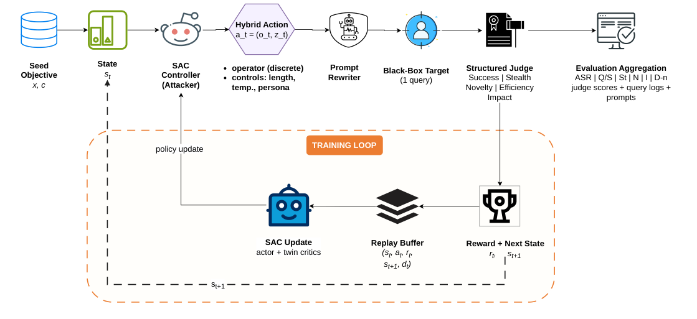
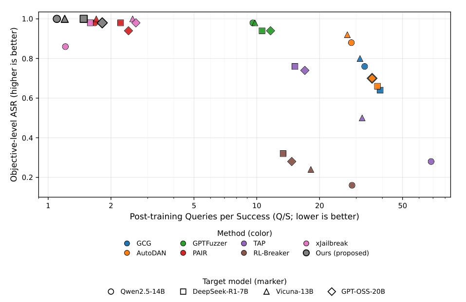
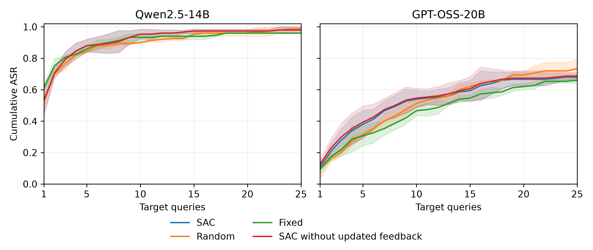

# Query-Budgeted Jailbreak Safety Auditing

Research implementation of a hybrid Soft Actor–Critic controller, frozen prompt rewriter, target-model interface, and structured judge for language-model safety auditing.

## Architecture and paper results

[Framework architecture diagram](docs/architecture.md) · [Results and tables](docs/results.md)







The architecture and trade-off figures are extracted from the supplied manuscript PDF. Vector PDFs and PNG previews are included. The architecture page also retains a Mermaid overview; the results page contains manuscript tables and the cumulative-ASR figure.

## Related workshop paper

[A Collaborative Multi-Agent Framework for Jailbreaking with RL-Based Dynamic Prompting](https://openreview.net/forum?id=hk3qQRuDwA), AAAI 2026 Workshop on Trust and Control in Agentic AI (TrustAgent).

The journal manuscript extends the workshop study. This source release includes controller code, baseline adapters, configuration files, evaluation and analysis scripts, and dataset inputs. It excludes experiment logs, generated responses, trained checkpoints, and model weights. A Zenodo DOI has not yet been assigned.

## Repository layout

- `jailbreak/src/`: controller, environment, rewriter, judge, data loaders, and baseline implementations.
- `jailbreak/config/`: model, training, baseline, and ablation configurations.
- `jailbreak/scripts/`: evaluation, sensitivity, and reporting utilities.
- `jailbreak/tests/`: existing project checks.
- `jailbreak/data/`: selected SORRY-Bench, JailbreakBench, and JailbreakHub source inputs, with upstream notices.

## Installation

Use a Python environment compatible with the dependencies in `requirements.txt`:

```bash
python -m venv .venv
source .venv/bin/activate
pip install -r requirements.txt
python -m jailbreak.src.cli --help
```

Run module commands from the repository root. Local model services and models must be installed separately. Configure endpoints and model identifiers for your machine before execution. Do not commit credentials or `.env` files.

## Experiment scope

The code supports training and evaluation workflows. The inspected Qwen2.5-14B and GPT-OSS-20B checkpoints used in the controller-feedback diagnostic had one-step terminal training records; repeated-attempt evaluation used frozen policies. Evaluation-seed repetitions assess variability conditional on saved checkpoints. This source release does not include those checkpoints and does not provide a claim that running the current code reproduces every historical reported value.

Some scripts retain experiment-specific paths and expect external checkpoint or output files. Review these paths before execution; scripts requiring excluded files are retained as analysis source, not standalone reproduction commands.

## Datasets and attribution

The `data/` directories preserve the upstream license and README files. Dataset sizes and source populations are distinct from the exact subsets used in individual experiments. In particular, the available JailbreakHub source has 390 questions; its inclusion does not identify the population behind every manuscript transfer result.

Third-party datasets and code remain subject to their original licenses. A project-wide software license should be selected by the authors before the public release.

## Citation

For the related workshop study, use the citation supplied by OpenReview:

```bibtex
@inproceedings{anonymous2026a,
  title={A Collaborative Multi-Agent Framework for Jailbreaking with {RL}-Based Dynamic Prompting},
  author={Anonymous},
  booktitle={AAAI 2026 Workshop on Trust and Control in Agentic AI (TrustAgent)},
  year={2026},
  url={https://openreview.net/forum?id=hk3qQRuDwA}
}
```
