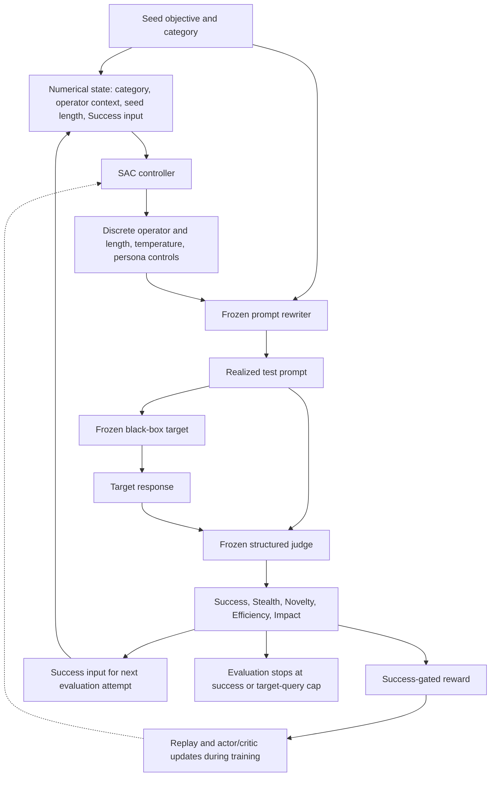

# Framework architecture

This Mermaid diagram summarizes the manuscript interface. It is a repository-native redraw, not the paper's original artwork.

During evaluation, all components are frozen. Rewriter and judge calls are auxiliary; submissions to the target count toward the target-query budget. The two inspected controller-feedback checkpoints have one-step terminal training records; the evaluation interface supports repeated attempts.

The manuscript references `Figure-Page-4.drawio.pdf`. That original asset was not present in the available workspace and has not been substituted with an unrelated figure.
