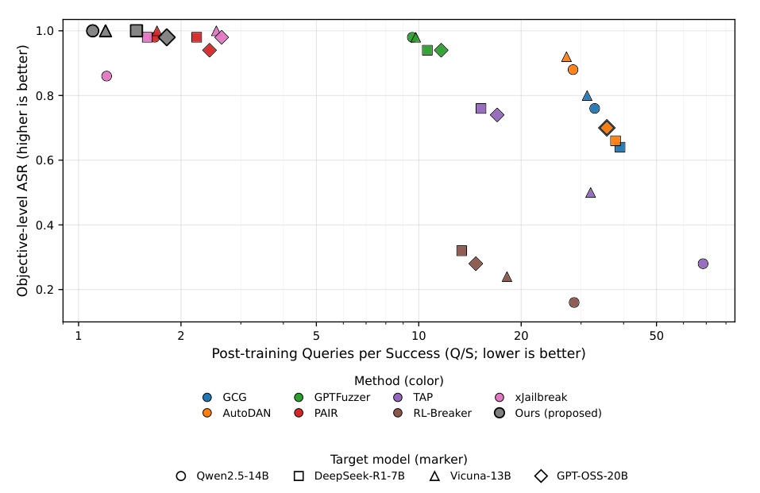
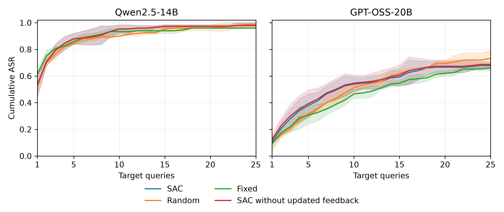

# Manuscript results

The table below is transcribed from the manuscript supplied for this update; it is not recomputed from checkpoints or logs. ASR measures objective-level success and Q/S includes target calls spent on unsuccessful objectives. Q/S excludes training and auxiliary inference costs.

## Primary comparison

Targets are Qwen2.5-14B, DeepSeek-R1-7B, Vicuna-13B, and GPT-OSS-20B; the evaluation target-query cap is 25 per objective.

| Method | Qwen ASR | Qwen Q/S | DeepSeek ASR | DeepSeek Q/S | Vicuna ASR | Vicuna Q/S | GPT-OSS ASR | GPT-OSS Q/S |
|---|---|---|---|---|---|---|---|---|
| GCG | 0.760 | 10.605 | 0.640 | 18.125 | 0.800 | 10.300 | 0.700 | 14.200 |
| AutoDAN | 0.880 | 7.159 | 0.660 | 16.667 | 0.920 | 5.587 | 0.700 | 16.743 |
| GPTFuzzer | 0.980 | 9.571 | 0.940 | 10.596 | 0.980 | 9.796 | 0.940 | 11.638 |
| PAIR | 0.980 | 1.673 | 0.980 | 2.224 | 1.000 | 1.700 | 0.940 | 2.426 |
| TAP | 0.280 | 68.500 | 0.760 | 15.237 | 0.500 | 32.000 | 0.740 | 17.000 |
| RL-Breaker | 0.160 | 28.625 | 0.320 | 13.375 | 0.240 | 18.167 | 0.280 | 14.714 |
| xJailbreak | 0.860 | 1.209 | 0.980 | 1.592 | 1.000 | 2.540 | 0.980 | 2.633 |
| Ours | 1.000 | 1.100 | 1.000 | 1.480 | 1.000 | 1.200 | 0.980 | 1.816 |

## Success–query trade-off

[Vector PDF](figures/asr_qs_tradeoff_updated.pdf). Extracted from page 21 of the supplied manuscript PDF.

## First-query performance and subsequent attempts

[Vector PDF](figures/controller_feedback_asr.pdf). Curves show means across three evaluation seeds and bands show one sample standard deviation. The four conditions use the same frozen rewriter. Selection outcomes differ by target, and updated versus fixed Success feedback gives similar aggregate performance.

## Table sources

[LaTeX tables](manuscript_result_tables.tex) preserve the manuscript's primary comparison, controller-feedback diagnostic, normalization sensitivity, rewriter sensitivity, and measured controlled-study costs.
